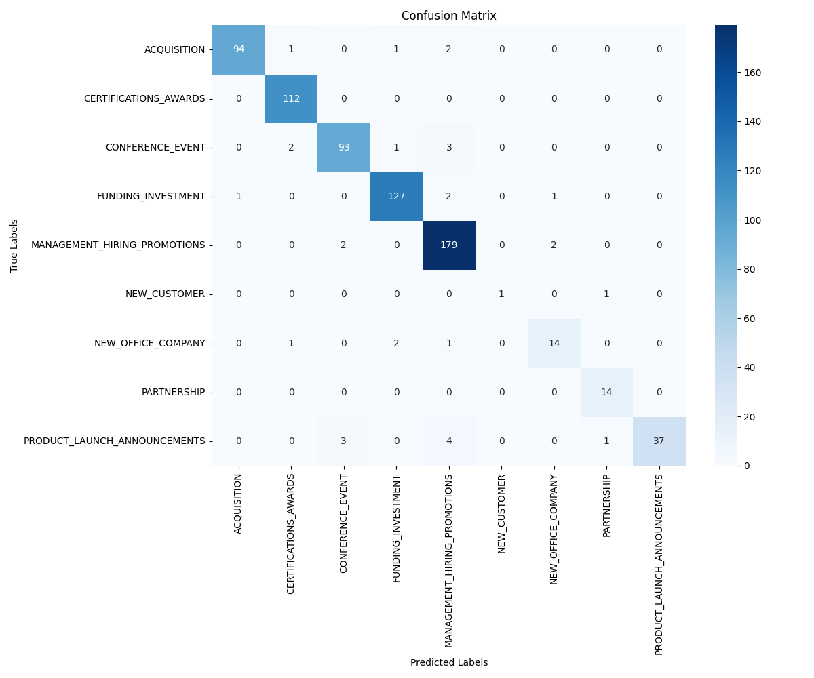

# News Classifier

A BERT-based text classifier that automatically sorts business/news articles into 9 categories — things like acquisitions, funding rounds, product launches, and hiring announcements. Built by fine-tuning `bert-base-uncased` on a labeled news corpus using Hugging Face `transformers`, with hyperparameter tuning via Optuna.

## What it does

Given the title and body text of a news article, the model predicts which of the following categories it belongs to:

- `ACQUISITION`
- `CERTIFICATIONS_AWARDS`
- `CONFERENCE_EVENT`
- `FUNDING_INVESTMENT`
- `MANAGEMENT_HIRING_PROMOTIONS`
- `NEW_CUSTOMER`
- `NEW_OFFICE_COMPANY`
- `PARTNERSHIP`
- `PRODUCT_LAUNCH_ANNOUNCEMENTS`

## Dataset

The model is trained on [`corpus.json`](corpus.json) — a set of **3,588 business news articles** (press-release style content, e.g. from PRWeb), each with a `title`, `text` body, and a `classificationCategory` label. Breakdown by category:

| Category | Articles |
|---|---|
| MANAGEMENT_HIRING_PROMOTIONS | 931 |
| FUNDING_INVESTMENT | 665 |
| CERTIFICATIONS_AWARDS | 577 |
| CONFERENCE_EVENT | 499 |
| ACQUISITION | 494 |
| PRODUCT_LAUNCH_ANNOUNCEMENTS | 229 |
| NEW_OFFICE_COMPANY | 91 |
| PARTNERSHIP | 89 |
| NEW_CUSTOMER | 13 |

The class imbalance here is worth calling out explicitly, since it directly explains some of the results below: `MANAGEMENT_HIRING_PROMOTIONS` has 71x more training examples than `NEW_CUSTOMER`. That's exactly why the model does noticeably worse on the smallest classes (`NEW_CUSTOMER`, `NEW_OFFICE_COMPANY`, `PARTNERSHIP`) — it simply sees far fewer examples of what those articles look like. If extending this project, addressing that imbalance (oversampling minority classes, class-weighted loss, or collecting more data for rare categories) would likely be the single highest-impact next step.

## How it works

1. **Data loading & cleaning** — Articles are loaded from the JSON corpus (`corpus.json`). Duplicate rows are dropped, and the `title` and `text` fields are concatenated into a single `combined` field that becomes the model input.
2. **Label encoding** — The `classificationCategory` column is label-encoded into integers using `sklearn`'s `LabelEncoder`.
3. **Train/val/test split** — The data is split 60/20/20 into train, validation, and test sets (`train_test_split`, with stratification in the later version of the script to keep class balance across splits).
4. **Tokenization** — Text is tokenized with `BertTokenizer` (`bert-base-uncased`), truncated/padded to a max length.
5. **Model** — `AutoModelForSequenceClassification` initialized from `bert-base-uncased`, with the classification head sized to the 9 categories.
6. **Hyperparameter search** — Optuna is used via Hugging Face's `Trainer.hyperparameter_search` to tune learning rate, batch size, number of epochs, and weight decay over 10 trials, optimizing for accuracy.
7. **Training** — The `Trainer` API handles the fine-tuning loop, with the best hyperparameters from the search applied before the final training run.
8. **Evaluation** — Precision, recall, F1 (weighted average), and accuracy are computed on the held-out test set, along with a full `classification_report` and a confusion matrix.
9. **Checkpointing** — The notebook also includes a script for resuming training from a saved checkpoint (useful since this was trained in Google Colab, where sessions can disconnect), and a separate inference script for running the trained model over a batch of new texts and returning predicted labels with confidence scores.

## Results

On the held-out test set (702 samples):

| Metric | Score |
|---|---|
| **Accuracy** | 95.58% |
| **Weighted F1** | 95.52% |
| **Weighted Precision** | 95.67% |
| **Weighted Recall** | 95.58% |

Per-class performance varies with how much data each category had — classes like `CERTIFICATIONS_AWARDS`, `FUNDING_INVESTMENT`, and `MANAGEMENT_HIRING_PROMOTIONS` (which had 100+ examples) perform best, while rarer classes like `NEW_CUSTOMER` (only 2 test examples) are noisier simply due to small sample size. Full per-class numbers are in [`classification_report.csv`](classification_report.csv).

### Confusion matrix

Most predictions land on the diagonal (correct), with a small amount of confusion between semantically related categories — e.g. a few `PRODUCT_LAUNCH_ANNOUNCEMENTS` articles get predicted as `MANAGEMENT_HIRING_PROMOTIONS`, likely because both types of articles often mention people/roles alongside the main news.

## Tech stack

- **Model**: `bert-base-uncased` (Hugging Face `transformers`)
- **Training loop**: Hugging Face `Trainer` / `TrainingArguments`
- **Hyperparameter search**: `optuna`
- **Data handling**: `pandas`, `datasets` (Hugging Face)
- **Metrics & evaluation**: `scikit-learn` (`classification_report`, `confusion_matrix`, `precision_recall_fscore_support`)
- **Visualization**: `matplotlib`, `seaborn`

## Repo contents

- `news_classification.ipynb` — the full notebook: data cleaning, tokenization, Optuna hyperparameter search, training, evaluation, checkpoint-resume logic, and batch inference.
- `corpus.json` — the training dataset: 3,588 labeled news articles (see [Dataset](#dataset) above).
- `classification_report.csv` — per-class precision/recall/F1/support on the test set.
- `confusion_matrix.png` — confusion matrix heatmap for test set predictions.

## Notes

- This was developed and trained in Google Colab (hence the `google.colab.drive` mount calls in the notebook) — if running locally, swap those out for local file paths, e.g. point `data_path` directly at `corpus.json` in this repo.
- The first main code cell is the primary training pipeline; the cells that follow it (checkpoint-resume training, standalone inference) are for continuing training after a Colab disconnect and for running inference with a saved model, respectively.
