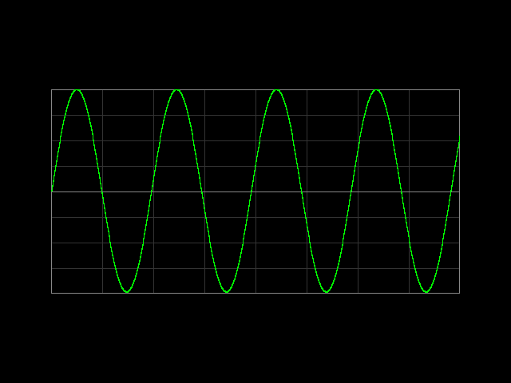

# FPGA Function Generator and Digital Oscilloscope (ZedBoard)

A function generator and a digital oscilloscope built inside the ZedBoard FPGA.
The generator puts out a real analog wave through a Pmod DA2.
The scope measures a real analog signal through a Pmod AD1 and draws it on a VGA monitor.
Join the two with a jumper wire and the scope shows the generator's own output.

The design also works with no Pmods at all: set SW6 to 0 and the scope looks at the
generator inside the FPGA.



## Hardware

| Part | Port | Job |
| --- | --- | --- |
| ZedBoard (Zynq-7020) | | All the logic, switches, reset button, VGA port |
| Pmod DA2 (12 bit DAC, output A used) | JA, top row | Analog output of the generator, 0 to 3.3 V |
| Pmod AD1 (12 bit ADC, input A used) | JB, top row | Analog input of the scope, 0 to 3.3 V |
| VGA monitor and cable | VGA | Shows the scope screen |
| 2 jumper wires | | DA2 output A to AD1 input A, and GND to GND |

Check the J2 header pin labels in the Digilent reference manuals for the Pmod DA2 and
Pmod AD1 before you connect the jumper wires. Keep the AD1 input between 0 and 3.3 V.

## Controls

| Control | Function |
| --- | --- |
| SW1 SW0 | Wave: 00 sine, 01 square, 10 triangle, 11 sawtooth |
| SW3 SW2 | Frequency: 00 100 Hz, 01 1 kHz, 10 5 kHz, 11 20 kHz |
| SW5 SW4 | Time scale (whole screen width): 00 1 ms, 01 4 ms, 10 16 ms, 11 65 ms |
| SW6 | Scope input: 0 the generator inside the FPGA, 1 the Pmod AD1 |
| BTNC (center button) | Reset |

Good settings: 100 Hz with 65 ms (about 6 cycles), 1 kHz with 4 ms (4 cycles),
5 kHz with 1 ms (5 cycles), 20 kHz with 1 ms (about 20 cycles).

## Folder map

| Folder | What is inside |
| --- | --- |
| `rtl/` | The Verilog design |
| `sim/` | The testbenches and simple Pmod models |
| `constraints/` | The ZedBoard pin file |
| `scripts/` | Vivado and simulation scripts |
| `docs/` | Pictures made by the simulation |

### Verilog files

| File | Job |
| --- | --- |
| `top.v` | Connects everything. Makes the 500 kHz sample tick and the 25 MHz pixel tick. |
| `sync2.v` | Two flip flop synchronizer for the switches and the button. |
| `dds.v` | Phase counter and wave maker. |
| `sine_rom.v` | 256 entry sine table (made by `scripts/gen_sine_rom.py`). |
| `spi_master16.v` | 16 bit SPI master at 12.5 MHz, used for both the DA2 and the AD1. |
| `scope_capture.v` | The capture FSM: WAIT, CAPTURE, DONE. |
| `sample_ram.v` | 2 banks of 512 samples. One is written while the other is shown. |
| `vga_timing.v` | 640 by 480 at 60 Hz timing. |
| `vga_display.v` | Draws the grid and the trace. |

## How it works

* **Generator.** 500 000 times a second, a 32 bit counter grows by a fixed number (the
  frequency tuning word). The top 8 bits of the counter make the wave.
  Output frequency = `ftw * 500 kHz / 2^32`.
* **DA2.** After each new sample, the SPI master sends one 16 bit frame to the DAC:
  2 unused bits, 2 power down bits (00 = on) and 12 data bits.
* **AD1.** At the same time a second SPI master reads one 16 bit frame from the ADC:
  4 zeros and then 12 data bits. The top 8 bits are kept.
* **Capture FSM.** It looks at the scope input. A counter skips samples to set the time scale.
  When the wave goes up through the middle level (128, about 1.65 V) the FSM saves 512 samples.
  If no crossing comes for a long time, it starts anyway so the screen never freezes.
* **Two RAM banks.** The FSM writes one bank while the screen reads the other.
  They swap once per frame, during the blank time, so the trace does not tear.
* **VGA.** 640 by 480 at 60 Hz. The 25 MHz pixel rate is a clock enable on the 100 MHz clock,
  so the whole design runs on one clock.

## Run the simulation (Icarus Verilog)

```
sudo apt install iverilog
bash scripts/run_sim.sh
python3 scripts/ppm_to_png.py build/sim/frame_*.ppm
```

| Test | What it checks |
| --- | --- |
| `tb_dds` | Range and frequency of all four waves |
| `tb_spi` | SPI frames to a DAC model and from an ADC model, 16 clock edges, 12.5 MHz |
| `tb_capture` | Saved samples, time scale, bank swap and time out |
| `tb_vga_timing` | Line length, frame length and sync widths |
| `tb_top` | Full design with the DA2 wired to the AD1. Saves a VGA frame, checks the trace in all 512 columns and the sample rate |

## Simulate in Vivado

1. Open Vivado. Pick Tools > Run Tcl Script and choose `scripts/create_project.tcl`.
   This makes the project `build/vivado_project/zed_scope.xpr` with all files added.
2. Click Run Simulation > Run Behavioral Simulation. The default test is `tb_top`.
   It runs to the end by itself (about 52 ms of sim time, so it can take a few minutes).
3. Read the result in the Tcl Console. It ends with `tb_top PASS`.
4. To run another test, right click it under Simulation Sources and pick Set as Top.
5. The picture `frame.ppm` is saved in `build/vivado_project/zed_scope.sim/sim_1/behav/xsim/`.

## Build and run on the ZedBoard

1. In the same project, click Generate Bitstream.
2. Set the boot jumpers JP7 to JP11 to JTAG mode (all to GND). Check that the VADJ jumper J18 is on 1.8 V.
3. Plug the Pmod DA2 into JA (top row) and the Pmod AD1 into JB (top row).
   Connect DA2 output A to AD1 input A, and GND to GND.
4. Connect the PROG micro USB port to the PC, connect a VGA monitor, and switch the board on.
5. Open Hardware Manager, click Open Target > Auto Connect, then Program Device.
6. Set SW6 to 1 and move the other switches. The screen shows the real analog wave.

From a terminal: `vivado -mode batch -source scripts/build.tcl`, then
`vivado -mode batch -source scripts/program.tcl`.

Only the FPGA part (PL) is used. The ARM processor is not used, so no Vitis step is needed.

## Things to know

* Pins and IO standards in `constraints/zedboard.xdc` match Digilent's official Zedboard-Master.xdc.
* The design was checked in simulation and with a 7-series synthesis run
  (about 760 cells and 1 block RAM). It has not yet been run on a real board.
* The monitor gets a 25.0 MHz pixel clock instead of the exact 25.175 MHz. Almost all monitors accept this.
* The sample rate is 500 kHz, so the 20 kHz wave has 25 samples per cycle.
* The LEDs are not used.
